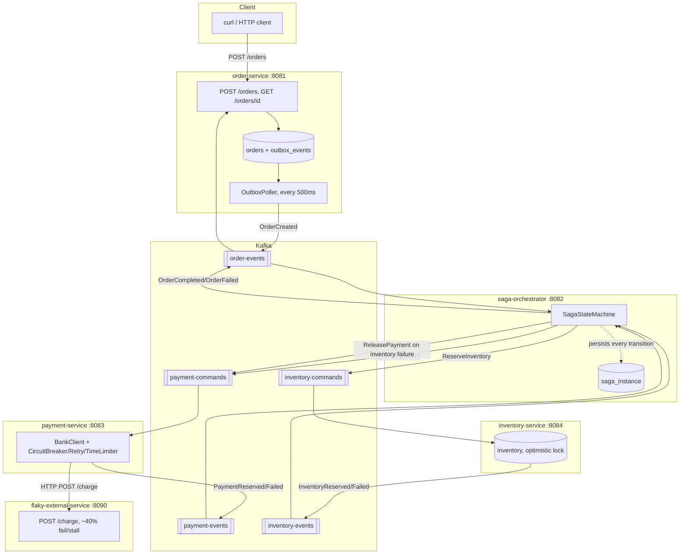
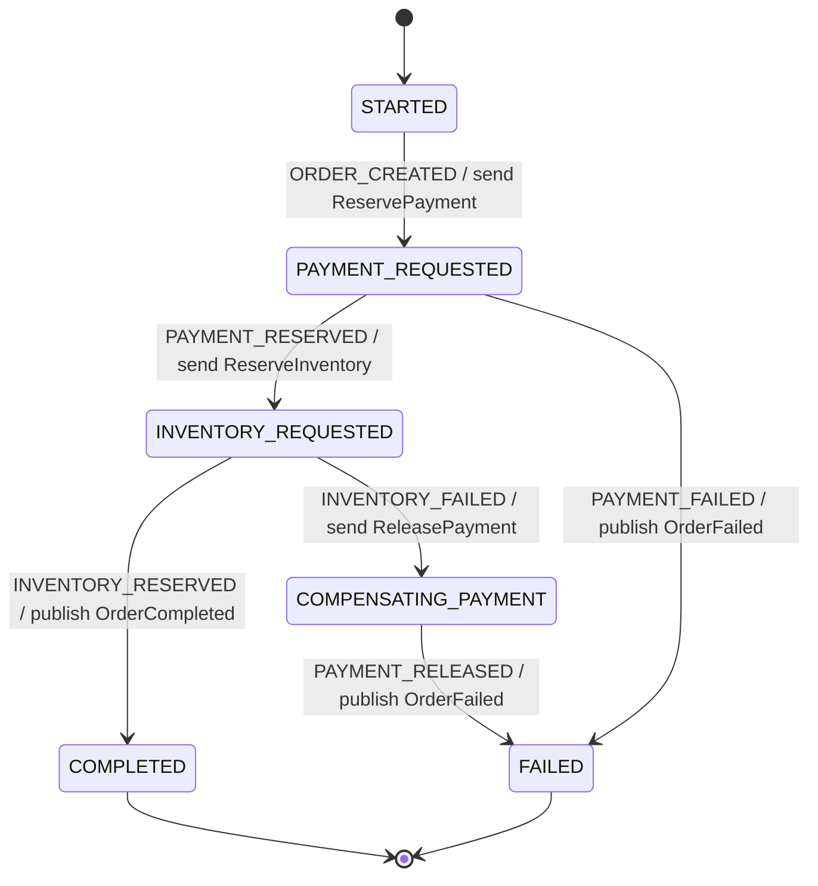

# microservices-reference-architecture

A portfolio reference project demonstrating production-grade distributed
system patterns with real, compiling Java code: **transactional outbox**,
**orchestration-based sagas** with an explicit state machine and crash
recovery, **circuit breaker / retry / time-limiter** resilience, **optimistic
locking**, and full observability (metrics, structured logs, distributed
tracing) across five Spring Boot 3 services coordinated over Kafka.

> **Scoping note**: this is a portfolio/reference project, not a
> production-hardened system. There is no authentication/authorization, no
> TLS anywhere (Kafka, Postgres and HTTP are all plaintext), no schema
> registry, secrets are hardcoded demo credentials, and topics have a single
> partition each. Those are all deliberate scope cuts to keep the focus on
> the distributed-systems patterns themselves - see "Corners cut" below for
> the full list.

## Architecture



### Saga state machine



## Services

| Service | Port | Responsibility |
|---|---|---|
| order-service | 8081 | Accepts orders, transactional outbox, polling publisher to `order-events` |
| saga-orchestrator | 8082 | Orchestrates payment + inventory reservation via an explicit saga state machine |
| payment-service | 8083 | Reserves/releases payment through a flaky external bank, protected by Resilience4j |
| inventory-service | 8084 | Reserves/releases stock with optimistic locking |
| flaky-external-service | 8090 | Simulated bank; randomly fails or stalls to exercise the circuit breaker |

## Why these patterns

**Transactional outbox (order-service).** Writing a new order to Postgres and
publishing an event to Kafka are two separate systems with no shared
transaction. If you write the DB row and then the Kafka publish fails (or the
process crashes in between), you get an order with no downstream event ever
firing - the "dual write" problem. The outbox pattern fixes this by writing
the event as a row in the *same* database transaction as the business entity
(`OrderService#createOrder`), so both commit atomically or neither does. A
separate poller (`OutboxPoller`, `@Scheduled` every 500ms) then reads
unpublished rows and ships them to Kafka, marking them published only after a
broker ack. Worst case on a poller crash mid-batch is an at-least-once
duplicate publish, which is a far easier failure mode to design around than a
silently lost event.

**Orchestration saga, not choreography (saga-orchestrator).** With four
services touching one business transaction (create order -> reserve payment ->
reserve inventory -> compensate on failure), choreography (each service
reacting to the previous service's event and deciding what to do next) spreads
the actual business process across every service's codebase, and turns
"what happens when inventory fails" into an implicit contract nobody can see
in one place. Orchestration puts that logic in one component with a durable,
explicit state machine (`SagaStateMachine`: an enum of steps plus a
transition table, not if/else chains scattered across listeners) - you can
read the whole saga in one file, and observability (which order is stuck
where, and why) comes for free from one table (`saga_instance`) instead of
having to correlate logs across four services. The tradeoff is a central
coordinator that has to actually be crash-recoverable to be trustworthy (see
below) and knows about every step, which is a deliberate coupling.

**Circuit breaker / retry / time limiter (payment-service).** The simulated
bank (`flaky-external-service`) is intentionally unreliable. Without a
circuit breaker, a degraded bank means every payment-service request thread
(and every Kafka consumer thread processing `payment-commands`) blocks
waiting on it, and the failure cascades into payment-service itself becoming
unresponsive. Resilience4j's CircuitBreaker tracks the failure rate over a
sliding window and, once it crosses `failure-rate-threshold`, opens the
circuit: further calls fail fast via a fallback instead of ever touching the
network, giving the bank time to recover (`wait-duration-in-open-state`)
before probing it again. Retry absorbs transient blips before they count
against the breaker; TimeLimiter bounds how long payment-service will wait on
a single call regardless of what the bank does. See "How to watch the circuit
breaker trip" below to see this live.

**Optimistic locking (inventory-service).** Two orders can race to reserve
the same SKU. Rather than pessimistically locking the row for the duration of
every reservation (which serializes all traffic against a SKU, including
readers), each `inventory` row carries a `@Version` column. Two concurrent
transactions can both read the row; whichever commits second gets an
`ObjectOptimisticLockingFailureException` instead of silently overwriting the
first writer's update. `InventoryReservationService` catches that and retries
against a freshly re-read row, bounded at 5 attempts - correct under
contention without holding locks.

## How to run

```bash
docker compose up --build
```

This builds all five services (multi-stage Dockerfiles: Maven build stage +
slim JRE runtime stage) and starts Kafka (KRaft mode, no Zookeeper), a single
Postgres instance with three databases (`orders_db`, `saga_db`,
`inventory_db`, one per service that needs one), Prometheus, Grafana and
Zipkin. Give it a minute or two on first run for all health checks to pass
and topics to become available.

### Trigger the demo flow

```bash
curl -s -X POST http://localhost:8081/orders \
  -H 'Content-Type: application/json' \
  -d '{"customerId":"cust-1","sku":"SKU-1","quantity":2,"amount":49.90}' | jq

# copy the returned "id", then poll it to watch the status change
# CREATED -> COMPLETED (or FAILED) as the saga runs asynchronously:
curl -s http://localhost:8081/orders/<id> | jq
```

`SKU-1` and `SKU-2` are seeded with plenty of stock (`inventory-service`'s
Flyway migration `V2__seed_demo_skus.sql`); `SKU-LOW-STOCK` is seeded with a
single unit, so ordering quantity > 1 of it deterministically exercises the
`InventoryFailed` -> compensate-payment -> `OrderFailed` path:

```bash
curl -s -X POST http://localhost:8081/orders \
  -H 'Content-Type: application/json' \
  -d '{"customerId":"cust-1","sku":"SKU-LOW-STOCK","quantity":5,"amount":10.00}' | jq
```

### Observe

- **Zipkin traces**: http://localhost:9411 - search by service name
  (`order-service`, `saga-orchestrator`, ...) to see the full trace of one
  order's journey across services (100% sampling is enabled for this demo).
- **Prometheus targets**: http://localhost:9090/targets - confirm all five
  `/actuator/prometheus` scrape targets are `UP`.
- **Grafana**: http://localhost:3000 (anonymous viewer access enabled, or
  admin/admin) - a basic provisioned dashboard ("Reference Architecture
  Overview") shows JVM heap, HTTP request rate, the payment-service circuit
  breaker state, and Kafka consumer throughput.

### Watch the circuit breaker trip

`flaky-external-service` fails or stalls ~40% of calls by default
(`FLAKY_FAILURE_RATE` env var). Fire a burst of orders to accumulate enough
calls to cross payment-service's configured threshold
(`minimum-number-of-calls: 5`, `failure-rate-threshold: 50`):

```bash
for i in $(seq 1 15); do
  curl -s -X POST http://localhost:8081/orders \
    -H 'Content-Type: application/json' \
    -d '{"customerId":"cust-1","sku":"SKU-1","quantity":1,"amount":9.99}' > /dev/null
done
```

Then tail payment-service's logs (structured JSON, includes `traceId`):

```bash
docker compose logs -f payment-service
```

Look for `Bank charge fallback triggered ... CallNotPermittedException:
CircuitBreaker 'bankCharge' is OPEN` - that's the breaker short-circuiting
without even attempting the HTTP call. Or check it directly:

```bash
curl -s http://localhost:8083/actuator/health | jq '.components.circuitBreakers'
curl -s http://localhost:8083/actuator/circuitbreakers | jq
```

## Kafka topics

| Topic | Producer(s) | Consumer(s) | Payload types |
|---|---|---|---|
| `order-events` | order-service, saga-orchestrator | saga-orchestrator, order-service | OrderCreated, OrderCompleted, OrderFailed |
| `payment-commands` | saga-orchestrator | payment-service | ReservePayment, ReleasePayment |
| `payment-events` | payment-service | saga-orchestrator | PaymentReserved, PaymentFailed, PaymentReleased |
| `inventory-commands` | saga-orchestrator | inventory-service | ReserveInventory (ReleaseInventory implemented, unused by current saga) |
| `inventory-events` | inventory-service | saga-orchestrator | InventoryReserved, InventoryFailed |

Every service owns its own copy of the message record types it needs (no
shared library) - a deliberate tradeoff of a little duplication for
independent deployability, matching how teams version topic contracts across
service boundaries in practice.

## Crash recovery

`saga-orchestrator` never keeps saga progress only in memory. Every incoming
Kafka event re-reads the current `SagaInstance` row from Postgres by
`orderId` before applying a transition, and `SagaRecoveryRunner`
(`ApplicationRunner`) logs every non-terminal saga found in the database on
startup. Kill `-9` the orchestrator mid-saga and restart it: the next event
for that order picks up exactly where the durable state left off.

## Local development (without Docker)

```bash
mvn -q -DskipTests package        # build every module
mvn test                          # run all unit tests (12 tests, no external services needed)
mvn -pl payment-service test      # e.g. just the circuit-breaker test, which boots a real
                                   # local HTTP server and Resilience4j's actual aspects
```

## Corners cut (given time/scope constraints)

- No authentication/authorization anywhere, no TLS on Kafka/Postgres/HTTP.
- No schema registry for Kafka messages - contracts are plain JSON records,
  hand-kept in sync per consuming service.
- Single Postgres container/instance for all three databases (fine for a
  demo; a real deployment would give each service its own instance).
- Kafka topics use default single partition - enough to demonstrate the
  patterns, not tuned for throughput or partition-key-based parallelism.
- `ReleaseInventoryCommand` is fully implemented in inventory-service but
  never actually triggered by the current two-step saga (only payment gets
  compensated, since inventory is the last step) - included because it's a
  real, working operation inventory-service should own, not because the demo
  flow exercises it today.
- No idempotency keys/deduplication table on consumers beyond the saga's own
  state-machine guards (`SagaStateMachine.canTransition`) rejecting
  transitions that don't apply to the current step - sufficient to survive
  Kafka's at-least-once delivery for this demo, but a production system
  would likely add an explicit processed-message ledger per consumer.
- No end-to-end/integration tests spinning up Testcontainers Kafka+Postgres;
  each module has focused unit tests instead (state machine transition
  table, outbox-write transactionality, optimistic-lock retry, circuit
  breaker actually tripping against a real local HTTP server, flaky endpoint
  failure-mode distribution).
