# Architecture

Complete architectural view of the reference system: context, components,
message contracts, runtime flows, resilience, observability and deployment
topologies. Every element below maps to real code in this repo - class names,
topics, ports and config values are taken from the source, not idealized.

For the "why" behind each pattern, see the [README](../README.md#why-these-patterns).

---

## 1. System context

Who talks to the system, and what it depends on.

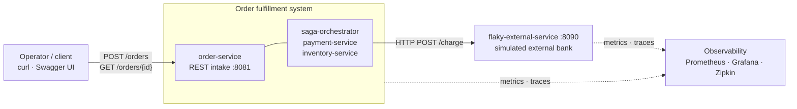

The bank is *inside* the repo but conceptually external: it is the untrusted,
unreliable dependency the resilience patterns exist to contain.

---

## 2. Component architecture

The full picture: services, their internal collaborators, their databases, and
every Kafka topic between them.

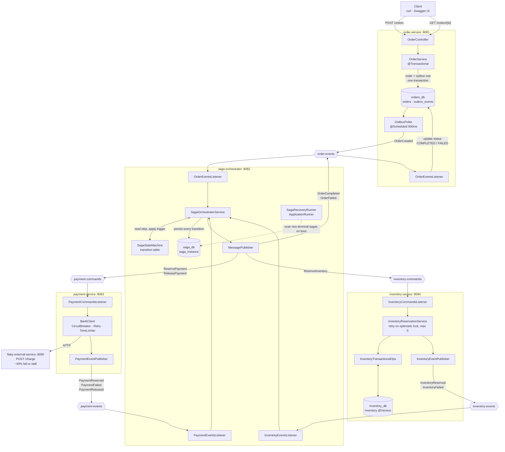

**Database-per-service.** Three logical databases (`orders_db`, `saga_db`,
`inventory_db`), each written only by its owning service. payment-service is
stateless - it owns no database, because a payment reservation here is a call
to the bank plus an event, with no local state worth persisting.

---

## 3. Message contracts

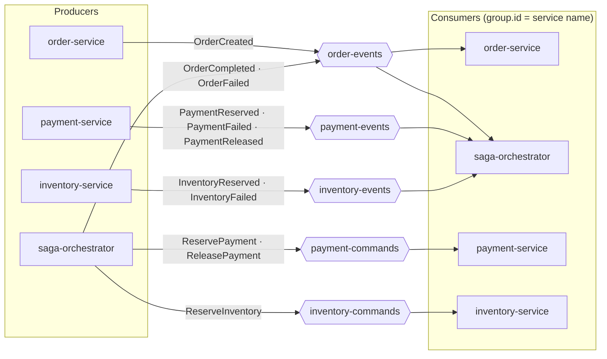

| Topic | Producers | Consumers | Payloads |
|---|---|---|---|
| `order-events` | order-service, saga-orchestrator | saga-orchestrator, order-service | `OrderCreated`, `OrderCompleted`, `OrderFailed` |
| `payment-commands` | saga-orchestrator | payment-service | `ReservePayment`, `ReleasePayment` |
| `payment-events` | payment-service | saga-orchestrator | `PaymentReserved`, `PaymentFailed`, `PaymentReleased` |
| `inventory-commands` | saga-orchestrator | inventory-service | `ReserveInventory`, `ReleaseInventory` (implemented, unused) |
| `inventory-events` | inventory-service | saga-orchestrator | `InventoryReserved`, `InventoryFailed` |

Commands are imperative and addressed to one owner; events are facts announced
to whoever cares. Each service declares its own copy of the record types it
consumes - no shared library, so no lockstep deploys.

---

## 4. Happy path

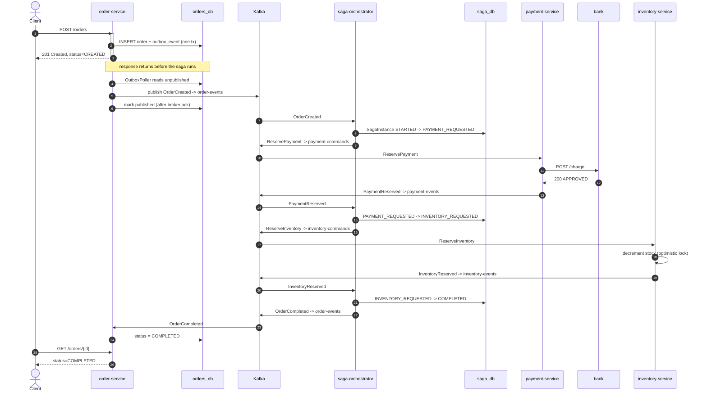

---

## 5. Compensation path

Inventory is the last step, so a failure there means payment already succeeded
and must be undone. This is what makes it a saga rather than a pipeline.

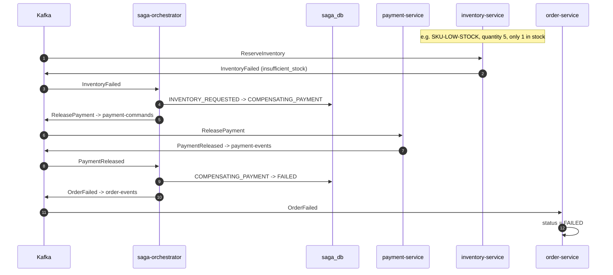

A payment failure short-circuits earlier: `PAYMENT_REQUESTED --PAYMENT_FAILED-->
FAILED`, with nothing to compensate because inventory was never touched.

---

## 6. Saga state machine

Six states, six declared transitions. Anything not in the table raises
`IllegalStateException` - which is how duplicate Kafka deliveries get rejected
instead of double-applied.

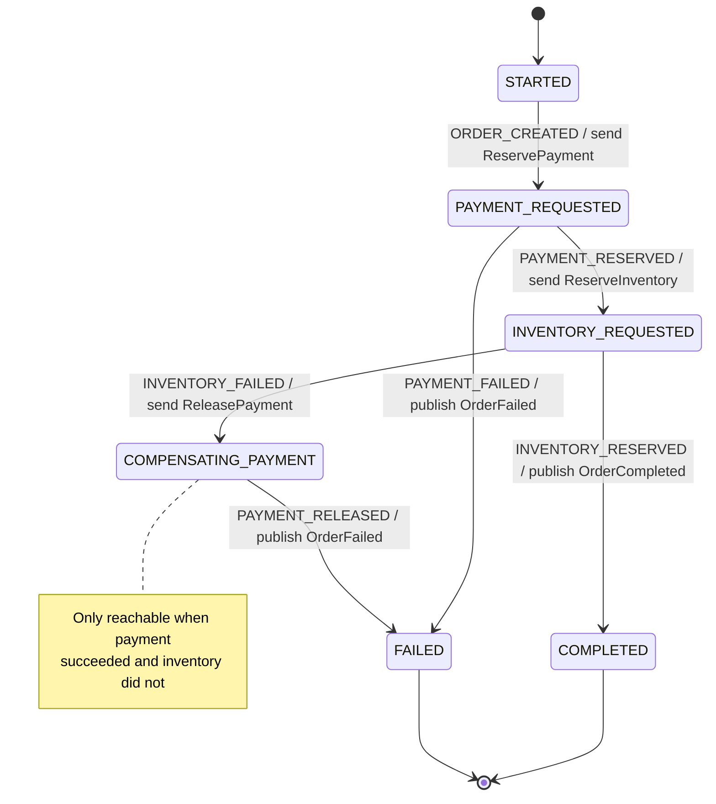

**Crash recovery.** State lives in `saga_instance`, never only in memory. Each
incoming event re-reads the row by `orderId` before applying a trigger, so a
`kill -9` mid-saga loses nothing: the next event resumes from the durable step.
`SagaRecoveryRunner` logs every non-terminal saga at startup.

---

## 7. Transactional outbox

The dual-write problem and how the outbox removes it.

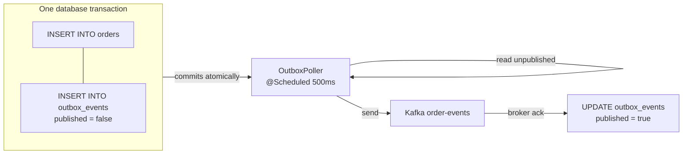

Both rows commit or neither does - no window where an order exists with no
event. A crash between publish and the `published = true` update replays the
event, so delivery is **at-least-once**, never at-most-once. Consumers absorb
the duplicate via the state machine's transition guard.

---

## 8. Resilience around the bank

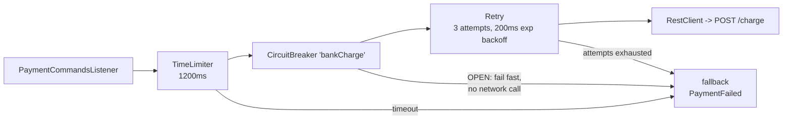

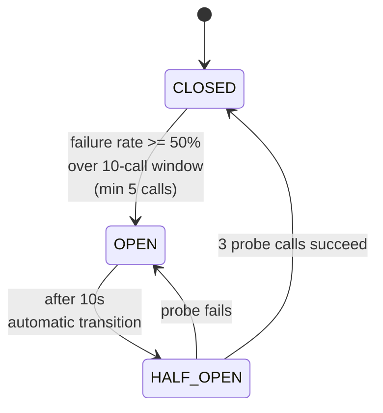

Config lives in `payment-service/src/main/resources/application.yml`:

| Knob | Value | Effect |
|---|---|---|
| `sliding-window-size` | 10 (count-based) | Decision window |
| `minimum-number-of-calls` | 5 | Below this, breaker stays closed |
| `failure-rate-threshold` | 50% | Trip point |
| `slow-call-duration-threshold` | 1500ms | Slow calls count as failures |
| `wait-duration-in-open-state` | 10s | Recovery window before probing |
| `permitted-number-of-calls-in-half-open-state` | 3 | Probe budget |
| TimeLimiter `timeout-duration` | 1200ms | Hard ceiling per call |
| Retry `max-attempts` | 3 | Absorbs transient blips pre-breaker |

The bank stalls for 3000ms on its slow path, well past both the 1200ms time
limit and the 1500ms slow-call threshold - stalls are guaranteed to register as
failures, which is what makes the breaker trip reproducibly.

---

## 9. Observability

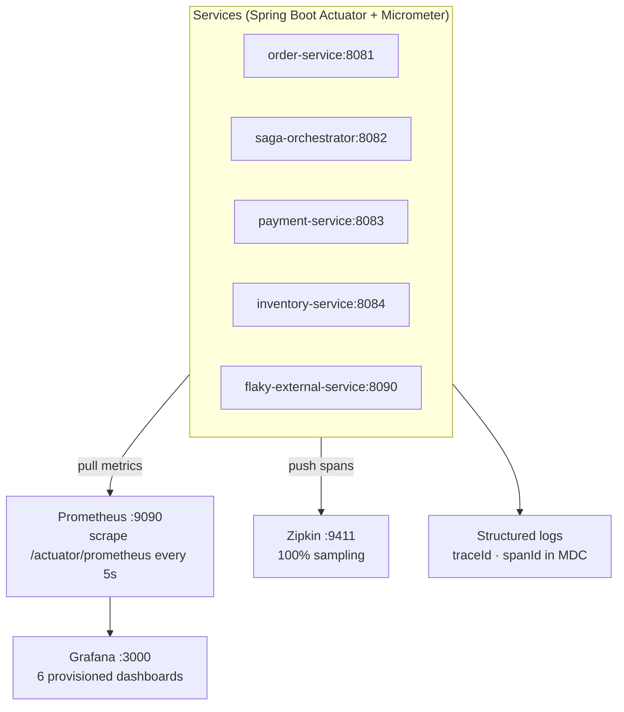

Trace context propagates across the whole flow - HTTP into order-service, then
through Kafka headers into every consumer - so one order is a single Zipkin
trace spanning all services. The same `traceId` appears in the JSON logs, which
is how you jump from a Grafana spike to the exact request.

| Dashboard | UID |
|---|---|
| Reference Architecture Overview | `refarch-overview` |
| Saga Flow - End to End | `refarch-flow-e2e` |
| Payment Resilience | `refarch-resilience` |
| Kafka Messaging | `refarch-kafka` |
| HTTP API | `refarch-http` |
| JVM & Runtime | `refarch-jvm` |

---

## 10. Deployment topologies

The same five services run in two environments. Application config is identical
because the k8s Service names deliberately match the compose service names.

### docker-compose

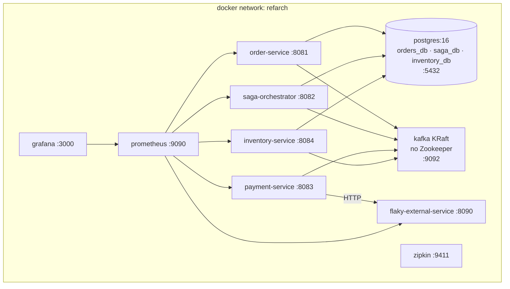

Startup ordering is enforced with health checks: Postgres reports healthy only
after `init-databases.sh` has created all three databases, so no service ever
boots against a half-initialized cluster.

### Kubernetes (minikube)

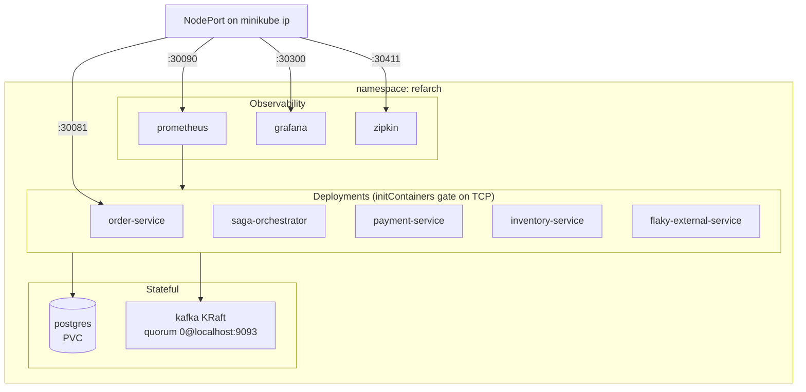

Deltas versus compose, all forced by Kubernetes semantics:

- **KRaft quorum uses `0@localhost:9093`, not `kafka:9093`.** A Service only
  publishes endpoints for *Ready* pods, so a self-reference through the Service
  would deadlock Kafka's own startup.
- **Heap capped** via `JAVA_TOOL_OPTIONS=-XX:MaxRAMPercentage=70` plus memory
  limits, so several JVMs fit on a laptop.
- **initContainers** block each app on Postgres/Kafka TCP reachability, the
  equivalent of compose's `depends_on: service_healthy`.
- **Images tagged `:local`** with `imagePullPolicy: IfNotPresent`, built inside
  minikube's docker daemon - no registry in the loop.

See [`k8s/README.md`](../k8s/README.md) for the deploy script and memory setup.

---

### AWS (ECS Fargate) - target deployment

A proposed production-style topology on AWS. It is a design target only; this repo
does not ship Terraform/CDK for it yet. Editable source:
[`diagrams/aws-ecs-architecture.drawio`](diagrams/aws-ecs-architecture.drawio)
(open it in [diagrams.net](https://app.diagrams.net) or the VS Code Draw.io extension).

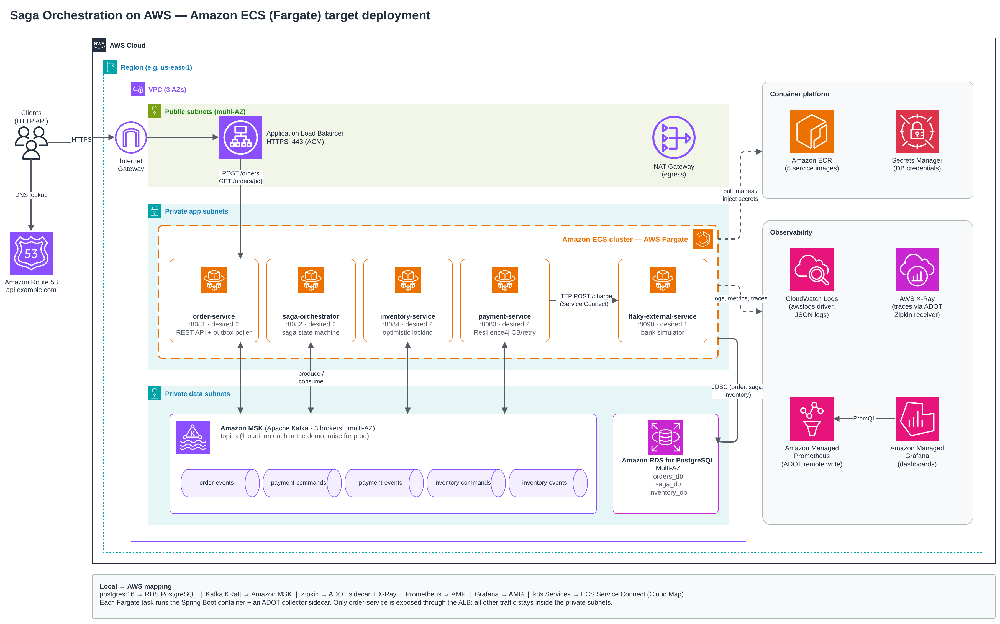

| Local / k8s component | AWS service |
| --- | --- |
| 5 Spring Boot containers | Amazon ECS on AWS Fargate (one ECS service per app, images in ECR) |
| `postgres:16` (orders_db, saga_db, inventory_db) | Amazon RDS for PostgreSQL, Multi-AZ, credentials in Secrets Manager |
| Kafka KRaft | Amazon MSK (same 5 topics) |
| k8s Service DNS names | ECS Service Connect (Cloud Map), so `FLAKY_SERVICE_URL` etc. keep working |
| Zipkin | ADOT collector sidecar (Zipkin receiver) to AWS X-Ray |
| Prometheus / Grafana | ADOT remote write to Amazon Managed Prometheus, dashboards in Amazon Managed Grafana |
| `docker logs` | CloudWatch Logs (`awslogs` driver) |

Only `order-service` sits behind the public Application Load Balancer; every
other service, MSK and RDS live in private subnets.

## 11. Design boundaries

What this architecture deliberately does *not* do - see the README's
["Corners cut"](../README.md#corners-cut-given-timescope-constraints) for the
full list:

- No authn/authz, no TLS on any hop (Kafka, Postgres, HTTP all plaintext).
- No schema registry - contracts are plain JSON records kept in sync by hand.
- One Postgres instance hosting three databases, rather than one instance each.
- Single-partition topics: enough to show the patterns, not tuned for
  partition-key parallelism.
- No consumer-side dedup ledger beyond the saga's own transition guards.
